# «Практика-Трекер» (Praktika Tracker) — MVP Release

[](https://www.python.org/)
[](https://fastapi.tiangolo.com/)
[-brightgreen.svg)]()
[](https://astral.sh/ruff)
[]()

> **Полнофункциональный программный комплекс сквозного управления и мониторинга производственной практики студентов ИТ-специальностей.**  
> Разработан в соответствии с требованиями Государственного общеобязательного стандарта высшего образования РК, Типовой формы № 107 МОН РК и академическими стандартами Факультета информационных технологий ЕНУ имени Л.Н. Гумилева (г. Астана).

---

## 👤 Сведения об авторе и проекте

- **Исполнитель (Solo PM & Full-cycle Developer):** Сәбитов Азамат
- **Учебная группа:** АЖ-47 (Кафедра искусственного интеллекта и Big Data, ФИТ)
- **Университет:** Евразийский национальный университет имени Л.Н. Гумилева (ЕНУ им. Л.Н. Гумилева, г. Астана)
- **Дисциплина / Проект:** Управление ИТ-проектами / Практикум сквозной разработки
- **Преподаватель / Руководитель практики:** Самбетбаева Мадина Аралбаевна
- **Модель разработки:** Гибридная модель поставки (*Hybrid Delivery Model*, см. [ADR-001](docs/adr/ADR-001-delivery-model.md)).

---

## 📌 Назначение и решаемая проблема

Ежегодно на 4 курсе бакалавриата факультета информационных технологий более **250 студентов** распределяются по 40+ ИТ-компаниям (Kaspi.kz, BTS Digital, Halyk Bank, Kolesa Group, АО «Казахтелеком» и др.). 

Ранее процесс велся вручную:
- Сбор бумажных гарантийных писем занимал от **14 до 21 рабочего дня**;
- Высокий процент опечаток в БИН предприятий и ИИН студентов приводил к возвратам приказов из юридического департамента;
- Деканат тратил до 40 рабочих часов на ручную сводку списков по базам практики и верстку официального приказа.

**Система «Практика-Трекер» автоматизирует 100% жизненного цикла:**
1. **Онлайн-подача заявки** студентом с мгновенной валидацией ИИН и БИН компании;
2. **Публичный трекер статуса** по ИИН с защитой персональных данных (маскирование ФИО и ИИН, Rate Limiting);
3. **Автоматическая генерация трехстороннего договора** в формате Word (.docx) по официальной **Форме № 107 МОН РК**;
4. **Загрузка и хранение скан-копий** подписанных договоров;
5. **Рабочее место координатора практики / деканата** с фильтрацией, аудитом действий и обязательным указанием причины отклонения;
6. **Автоматическая генерация сводного проекта приказа декана** в формате Word (.docx) с группировкой студентов по базам практики в алфавитном порядке и выделением нераспределенных обучающихся;
7. **Выгрузка единого реестра в Excel/CSV** с кодировкой UTF-8 BOM.

---

## 🏛 Архитектура и стек технологий

```mermaid
graph TD
    Client[Пользовательский браузер<br>Студент / Координатор / Деканат]
    
    subgraph Frontend["Frontend Layer (Bilingual KZ / RU)"]
        UI_Home["Главная страница /"]
        UI_Apply["Подача заявки /apply"]
        UI_Track["Трекер по ИИН /tracker"]
        UI_Coord["Кабинет деканата /coordinator"]
        UI_Comp["Каталог баз /companies"]
        StaticJS["Vanilla JS + Bootstrap 5 + Toasts"]
    end
    
    subgraph Backend["Backend API Layer (FastAPI)"]
        RateLimit["Rate Limiter (SlowAPI)"]
        AuthMiddleware["CORS & Request Handler"]
        AppRouter["/api/v1/applications"]
        TrackRouter["/api/v1/tracker"]
        OrderRouter["/api/v1/orders"]
        CompRouter["/api/v1/companies"]
        ExportRouter["/api/v1/export"]
    end

    subgraph CoreServices["Domain Services Engine"]
        IINVal["IIN Validator (KGD RK Alg)"]
        BINVal["BIN Validator (Weights W1/W2)"]
        ContractGen["DOCX Generator (Form 107)"]
        OrderGen["Dean Order Generator (DOCX)"]
        AuditService["Append-Only Audit Log"]
    end

    subgraph DataStorage["Data Persistence"]
        DB[(SQLite / PostgreSQL)]
        FileStore["Storage (DOCX Documents & Scans)"]
    end

    Client --> Frontend
    Frontend --> Backend
    Backend --> CoreServices
    CoreServices --> DataStorage
```



### Технологический стек:
- **Backend Core:** Python 3.11–3.13, FastAPI, Pydantic v2, Uvicorn;
- **База данных и ORM:** SQLAlchemy 2.0, SQLite (для мгновенного локального запуска без зависимостей) и PostgreSQL (для контейнерной среды Docker);
- **Генерация документов:** `python-docx` с поддержкой таблиц, стилей Times New Roman, колонтитулов и печатей;
- **Безопасность и NFR:** SlowAPI (Rate Limiting 10 req/min), валидация контрольных разрядов КГД РК, маскирование ПДн (ФЗ РК «О персональных данных»), неизменяемый аудит-лог;
- **Frontend:** Jinja2 Templates, Bootstrap 5.3, Bootstrap Icons, нативный асинхронный JavaScript с поддержкой переключения языков (RU/KZ);
- **Тестирование и контроль качества:** Pytest (54 теста, 88% покрытия), Ruff (Linter & Formatter).

---

## 🚀 Быстрый запуск

### Вариант 1: Локальный запуск (Рекомендуемый, без внешних зависимостей)

Благодаря встроенному SQLite и автоматическому предзаполнению базы данных демонстрационными данными, проект запускается за 1 команду:

```powershell
# 1. Перейдите в каталог проекта
cd praktika-tracker

# 2. Установите зависимости (если еще не установлены)
pip install -r requirements.txt

# 3. Запустите сервис
python run.py
```

После старта веб-интерфейс доступен по адресам:
- 🌐 **Главная страница:** [http://127.0.0.1:8000/](http://127.0.0.1:8000/)
- 📝 **Подача заявки студентом:** [http://127.0.0.1:8000/apply](http://127.0.0.1:8000/apply)
- 🔍 **Публичный трекер по ИИН:** [http://127.0.0.1:8000/tracker](http://127.0.0.1:8000/tracker)
- 📊 **Кабинет координатора / деканата:** [http://127.0.0.1:8000/coordinator](http://127.0.0.1:8000/coordinator)
- 🏢 **Каталог аккредитованных компаний:** [http://127.0.0.1:8000/companies](http://127.0.0.1:8000/companies)
- 📚 **Интерактивная документация Swagger/OpenAPI:** [http://127.0.0.1:8000/docs](http://127.0.0.1:8000/docs)

---

### Вариант 2: Запуск в Docker Compose (Production-ready с PostgreSQL)

```bash
docker compose up -d --build
```
Сервис поднимет изолированный контейнер с PostgreSQL 16 и контейнер с FastAPI веб-сервером.

---

## 🧪 Демонстрационные данные для проверки преподавателем

В базу данных уже предзаполнены аккредитованные предприятия и тестовые студенты:

### 1. Проверка трекера по ИИН (`/tracker`):
| ИИН студента | ФИО студента | База практики | Текущий статус | Особенности |
|---|---|---|---|---|
| `030514500012` | Сәбитов Азамат | Kaspi.kz | `in_order` (В приказе) | Доступно скачивание договора |
| `030822600023` | Ибрагимова Динара | BTS Digital | `approved` (Согласовано) | Доступно скачивание договора |
| `031110500039` | Омаров Руслан | АО «Казахтелеком» | `under_review` (На рассмотрении) | В очереди деканата |
| `030219600045` | Нұрланұлы Бауыржан | Kolesa Group | `rejected` (Отклонено) | Отображается обоснованная причина |
| `030704500055` | Смагулова Адель | АО «Народный Банк» | `under_review` (На рассмотрении) | В очереди деканата |

### 2. Проверка валидатора БИН при подаче заявки (`/apply`):
- **Валидный БИН Kaspi Bank:** `081240012740` (система подтверждает статус юридического лица);
- **Валидный БИН АО «Казахтелеком»:** `941240000193`;
- **Валидный БИН BTS Digital:** `200540001235`;
- **Невалидный БИН для проверки валидации:** `123456789012` (система выведет ошибку контрольного разряда по алгоритму КГД РК).

---

## 📋 Реализованный функционал (Трассировка User Stories и WBS)

| ID требований | Наименование | Реализация в MVP |
|---|---|---|
| **US-01 / US-04** | Подача заявки на практику | Форма `/apply` с проверкой корректности данных, дат практики и группы |
| **US-02 / US-07** | Каталог баз практики с проверкой БИН | Страница `/companies` + API добавления партнеров с валидацией БИН |
| **US-05 / US-06** | Панель деканата и согласование | Кабинет `/coordinator` с модальным окном причины при отклонении заявки |
| **US-08** | Загрузка скан-копии договора | Эндпоинт `/api/v1/applications/{id}/upload-scan` (PDF/JPG до 10 МБ) |
| **US-09 / WBS 1.3.3** | Формирование договора Word | Модуль `document_generator.py` (Типовая Форма № 107 МОН РК) |
| **US-10** | Выгрузка реестра в Excel/CSV | Эндпоинт `/api/v1/export/csv` с UTF-8 BOM для корректного открытия в Excel |
| **US-11 / WBS 1.3.4** | Сводный приказ декана Word | Модуль `order_generator.py` с алфавитной сортировкой и списком нераспределенных |
| **US-14 / SEC-01** | Публичный трекер и защита от спама | Страница `/tracker` + Rate Limiting (SlowAPI) + маскирование ПДн |
| **SEC-02 / НФТ-07** | Аудит изменений статусов | Таблица `status_audit_logs` с фиксацией автора, времени и комментариев |
| **НФТ-10** | Двуязычный интерфейс | Переключатель языков RU/KZ в верхней навигационной панели |

---

## 🔬 Тестирование и качество кода

Тестовый набор покрывает как алгоритмическую валидацию (ИИН, БИН), так и сквозные сценарии интеграции (End-to-End API Workflows):

```powershell
# Запуск тестов с замером покрытия
cd praktika-tracker
pytest -v --cov=src --cov-report=term
```

**Результаты прогона тестов:**
```text
============================= test session starts =============================
collected 54 items

tests/test_api_endpoints.py::test_api_validate_bin_success PASSED        [  1%]
tests/test_api_endpoints.py::test_api_validate_bin_failure PASSED        [  3%]
...
tests/test_bin_validator.py (11 tests) PASSED                            [ 31%]
tests/test_contract_service.py (5 tests) PASSED                          [ 40%]
tests/test_health.py (2 tests) PASSED                                    [ 44%]
tests/test_iin_validator.py (21 tests) PASSED                            [ 74%]
tests/test_mvp_workflow.py (15 tests) PASSED                             [100%]

=============================== tests coverage ================================
TOTAL: 1074 statements, 88% test coverage
======================= 54 passed in 2.74s =======================
```

Проверка статическим анализатором Ruff:
```powershell
ruff check .
# All checks passed!
```

---

## 📁 Структура проекта

```text
praktika-tracker/
├── pyproject.toml              # Конфигурация Ruff, Pytest и зависимостей
├── requirements.txt            # Зафиксированные версии пакетов
├── run.py                      # Единая точка запуска локального сервера
├── docker-compose.yml          # Развертывание PostgreSQL и API в Docker
├── Dockerfile                  # Многоэтапная сборка контейнера
├── docs/                       # Проектная документация (ADR, конвенции, DoR/DoD)
├── storage/                    # Хранилище сгенерированных документов и сканов
│   ├── contracts/              # Договоры в формате DOCX
│   └── documents/              # Сводные приказы декана в формате DOCX
├── src/
│   ├── main.py                 # Инициализация FastAPI приложения и маршрутизации
│   ├── core/                   # Глобальные настройки и Rate Limiting
│   ├── database/               # Модели SQLAlchemy, сессии и сидер данных
│   ├── schemas/                # Pydantic v2 схемы валидации DTO
│   ├── services/               # Бизнес-логика: валидаторы ИИН/БИН, генераторы DOCX, CSV экспорт
│   ├── api/                    # REST API эндпоинты (applications, tracker, orders, companies)
│   ├── static/                 # CSS стили и JavaScript (валидация на лету, тосты, локализация)
│   └── templates/              # Jinja2 HTML шаблоны веб-интерфейса
└── tests/                      # Набор из 54 автоматизированных тестов
```

---

## 📜 Соответствие академическим требованиям

Проект спроектирован и разработан единолично студентом группы **АЖ-47 Сәбитовым А. Б.** в рамках сквозного цикла лабораторных работ ЛЗ 1–10:
- Структурирован в соответствии с проектной документацией (User Stories, WBS, Story Map, NFR ISO 25010);
- Документирован с открытыми спецификациями OpenAPI/Swagger;
- Обеспечивает реальную автоматизацию университетских бизнес-процессов ФИТ ЕНУ им. Л.Н. Гумилева (г. Астана).
