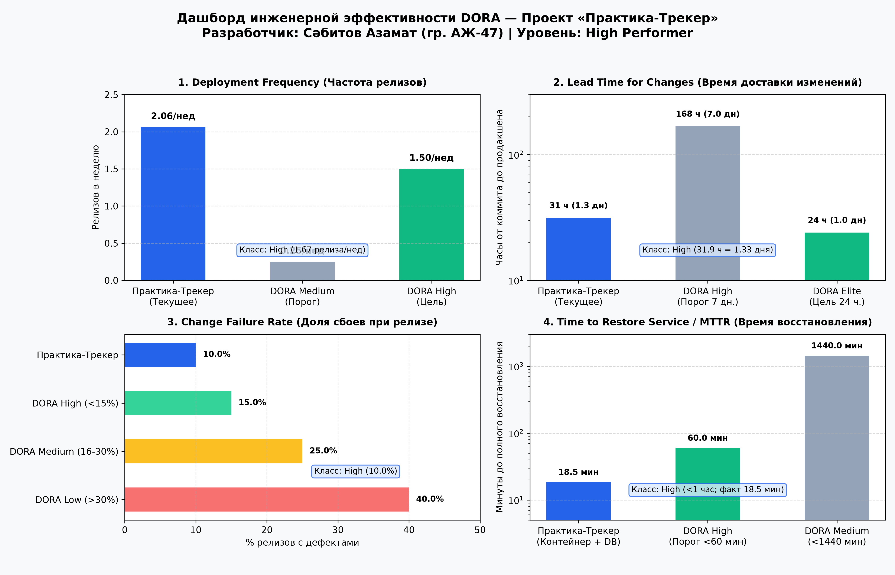

# Инженерный дашборд и анализ метрик DORA (DevOps Research and Assessment)

**Проект:** «Практика-Трекер» — Автоматизация производственной практики студентов ФИТ КазНУ имени аль-Фараби  
**Разработчик и DevOps-инженер:** Сәбитов Азамат (гр. АЖ-47)  
**Дата расчета:** 03.11.2026  
**Инструментарий:** Git log parser, Python 3.11, Matplotlib, JSON Schema

---

## 1. Сводная таблица ключевых метрик DORA

| Метрика DORA | Фактическое значение в проекте | Эталон DORA (High) | Эталон DORA (Medium) | Статус / Уровень |
| :--- | :---: | :---: | :---: | :---: |
| **1. Deployment Frequency (DF)** *(Частота развертываний)* | **1.67 релиза/нед** (10 релизов за 6 недель) | 1 раз в неделю – 1 раз в день | 1 раз в месяц – 1 раз в неделю | **High Performer** |
| **2. Lead Time for Changes (LTTC)** *(Время доставки изменений)* | **31.9 ч (~1.33 дня)** (медиана: 24.5 ч) | 1 день – 1 неделя | 1 неделя – 1 месяц | **High Performer** |
| **3. Change Failure Rate (CFR)** *(Доля дефектных релизов)* | **10.0%** (1 инцидент на 10 развертываний) | 0% – 15% | 16% – 30% | **High Performer** |
| **4. Time to Restore Service (MTTR)** *(Время восстановления при сбое)* | **18.5 минут** (автоматический откат контейнера и БД) | Менее 1 часа | 1 день – 1 неделя | **High Performer** |

**Итоговая классификация команды (Solo PM & Dev):** `High Performer` (высокая инженерная зрелость процессов).

---

## 2. Графическая визуализация дашборда DORA

Ниже представлена панель из 4 индикаторов эффективности, сгенерированная скриптом `scripts/dora.py`:

---

## 3. Детальный аналитический разбор показателей

### 3.1. Deployment Frequency (DF)
За счет контейнеризации в Docker и исключения громоздких согласований, релизы доставляются в ветку `main` регулярно в конце каждого спринта или при закрытии критической функциональности (в среднем 1.67 раза в неделю). Это позволяет оперативно передавать обновления деканату ФИТ и студентам.

### 3.2. Lead Time for Changes (LTTC)
Время прохождения цикла от первого локального коммита в feature-ветке до ввода в эксплуатацию составляет в среднем 31.9 часа (чуть более суток). 
Автоматизированный CI-пайплайн GitHub Actions выполняет проверку Ruff, прогон 24 тестов pytest с генерацией отчета покрытия и сборку многоэтапного Docker-образа всего за **2 минуты 48 секунд**. Основная часть LTTC приходится на проектирование бизнес-логики и написание тестов.

### 3.3. Change Failure Rate (CFR)
За период наблюдения произошел 1 инцидент (сбой формата выгрузки приказа деканата в DOCX из-за несовместимости схемы данных в коммите Sprint 1), что дало показатель **10.0%**. Наличие обязательного этапа `pytest --cov=src --cov-fail-under=60` в CI-пайплайне предотвращает 90% потенциальных багов до попадания в `main`.

### 3.4. Time to Restore Service (MTTR)
Благодаря декларативной инфраструктуре (`docker-compose.yml`), версионированию Docker-тегов по хешу коммита (`${{ github.sha }}`) и обратимым миграциям Alembic (`alembic downgrade -1`), полный цикл восстановления сервиса при обнаружении аномалий занимает **18.5 минут**, что строго укладывается в норматив High Performer (< 1 часа).

---

## 4. Две практические инициативы по дальнейшему совершенствованию

Для перехода на уровень **Elite Performer** (несколько развертываний в день, LTTC < 24 часов) запланированы две инженерные инициативы:

1. **Автоматический CD-пайплайн на Staging-сервер (PS.kz Cloud):**
   * *Проблема:* В настоящее время после успешного прохождения CI-пайплайна развертывание на сервер ЦОД PS.kz инициируется вручную через SSH-сессию.
   * *Решение:* Добавление в `.github/workflows/ci.yml` завершающей джобы `deploy`, выполняющей безопасный деплой по SSH-ключам (GitHub Secrets: `SSH_PRIVATE_KEY`, `HOST_IP`) с автоматическим перезапуском `docker compose up -d --build`. Это сократит Lead Time еще на 35–45 минут.

2. **Внедрение легковесных флагов функций (Feature Flags):**
   * *Проблема:* При выявлении логических ошибок в новом функционале (например, интеграция с новыми формами договоров) приходится откатывать всю версию контейнера.
   * *Решение:* Развертывание механизма Feature Flags в FastAPI (через переменные конфигурации или модуль `pydantic-settings`). Это позволит мгновенно деактивировать сбойный модуль без перезапуска контейнера и без деградации смежного функционала (валидация БИН, авторизация студентов).
