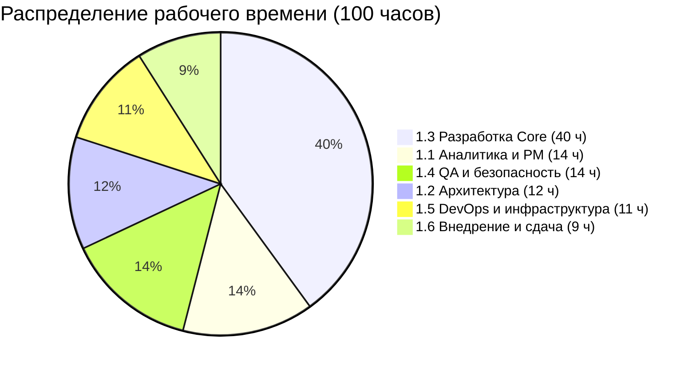

# Расчет реальной мощности (Capacity Planning) проекта «Практика-Трекер»

**Проект**: Веб-сервис «Практика-Трекер»  
**Исполнитель**: Сәбитов Азамат (гр. АЖ-47, Solo PM & Full-cycle Developer)  
**Дисциплина**: Управление ИТ-проектами (Неделя 5, ЛЗ 5)  
**Связанный документ**: [ЛЗ 5. Сәбитов Азамат Аж-47.docx](file:///c:/Users/azama/Downloads/Шекербек%20лаб/ЛЗ%205.%20Сәбитов%20Азамат%20Аж-47.docx)

---

## 1. Методология ресурсного планирования и ошибка «100% загрузки»

В проектном менеджменте классической ошибкой является планирование работ исходя из 100% доступности человеческих ресурсов (теория очередей и теория ограничений Голдратта показывают, что при загрузке системы свыше 80% время ожидания стремится к бесконечности).

Для индивидуального студенческого проекта ресурсный расчет строится с обязательным дисконтированием учебной нагрузки:
- Экзаменационные сессии и рубежные контроли (РК-1 и РК-2);
- Дедлайны по параллельным дисциплинам семестра (курсовые работы, СРО);
- Эффект когнитивного переключения контекста (Context Switching Cost);
- Непредвиденные технические риски и багфиксинг.

---

## 2. Математический расчет реальной Capacity разработчика

Расчет чистого доступного рабочего времени на весенний семестр 2026 года (15 учебных недель):

| Статья ресурсного бюджета | Параметры расчета | Объем часов | Доля фонда |
|---|---|:---:|:---:|
| **Номинальный доступный фонд времени** | 1 разработчик $\times$ 15 недель $\times$ 12 часов в неделю | **+180 ч** | 100.0% |
| *Вычет 1: Рубежные контроли и аттестации* | 2 недели контроля (РК-1 на 7-й нед., РК-2 на 14-й нед.) $\times$ 12 ч | **-24 ч** | -13.3% |
| *Вычет 2: Смежная учебная нагрузка* | Подготовка к СРО, практикам и лабораторным по другим предметам (2 ч/нед $\times$ 15 нед) | **-30 ч** | -16.7% |
| *Вычет 3: Риск-буфер на неопределенность* | Резерв на исправление багов, технический долг и форс-мажоры (20% от доступного остатка) | **-26 ч** | -14.4% |
| **Реальная чистая мощность (Net Capacity)** | **180 - 24 - 30 - 26 = 100 рабочих часов** | **100 ч** | **55.6%** |

### Ключевой аналитический вывод:
Реальная чистая мощность исполнителя составляет **ровно 100 рабочих часов** (в среднем **6.67 часа чистой сфокусированной разработки в неделю**). Именно на эту цифру калибруется суммарный объем работ структуры WBS.

---

## 3. Аллокация Capacity по пакетам WBS

Сравнение оценок пакетов WBS и доступной емкости:

| Фаза WBS | Объем работ WBS | Аллокация часов | Процент от Capacity |
|---|---|:---:|:---:|
| **1.1 Управление и требования** | Пакеты 1.1.1 – 1.1.4 | 14 ч | 14% |
| **1.2 Архитектура и проектирование** | Пакеты 1.2.1 – 1.2.4 | 12 ч | 12% |
| **1.3 Разработка функционала (Core)** | Пакеты 1.3.1 – 1.3.5 | 40 ч | 40% |
| **1.4 Тестирование и безопасность** | Пакеты 1.4.1 – 1.4.4 | 14 ч | 14% |
| **1.5 Инфраструктура и DevOps** | Пакеты 1.5.1 – 1.5.4 | 11 ч | 11% |
| **1.6 Внедрение и эксплуатация** | Пакеты 1.6.1 – 1.6.3 | 9 ч | 9% |
| **ИТОГО** | **Полная структура WBS** | **100 ч** | **100%** |

---

## 4. Календарный график распределения нагрузки по спринтам

Проект разделен на 6 двухнедельных спринтов и финальную неделю сдачи:

| Спринт / Период | Учебные недели | Задачи спринта | Плановая нагрузка | Доступный буфер |
|---|:---:|---|:---:|:---:|
| **Спринт 1** (02.02 – 15.02) | Недели 1–2 | Инициация, CustDev-интервью, WBS, ADR-001 | 14 ч | 4 ч |
| **Спринт 2** (16.02 – 27.02) | Недели 3–4 | Схема БД, контракты API, Docker, каркас (Веха M1) | 16 ч | 3 ч |
| **Спринт 3** (02.03 – 15.03) | Недели 5–6 | Валидация БИН, шаблоны договоров DOCX/PDF | 18 ч | 3 ч |
| **Спринт 4** (16.03 – 27.03) | Недели 7–8 | Кабинет координатора, сводный приказ, VPS (Веха M2) | 18 ч (РК-1) | 4 ч |
| **Спринт 5** (30.03 – 12.04) | Недели 9–10 | Запуск пилотной кампании, исправление дефектов | 12 ч | 4 ч |
| **Спринт 6** (13.04 – 26.04) | Недели 11–12 | Telegram-бот, дашборд аналитики покрытия | 12 ч | 4 ч |
| **Финализация** (27.04 – 15.05) | Недели 13–15 | Подготовка отчета, защита перед деканатом (Веха M3) | 10 ч (РК-2) | 4 ч |
| **ВСЕГО** | **15 недель** | **Полный релизный цикл системы** | **100 ч** | **26 ч (Резерв)** |
