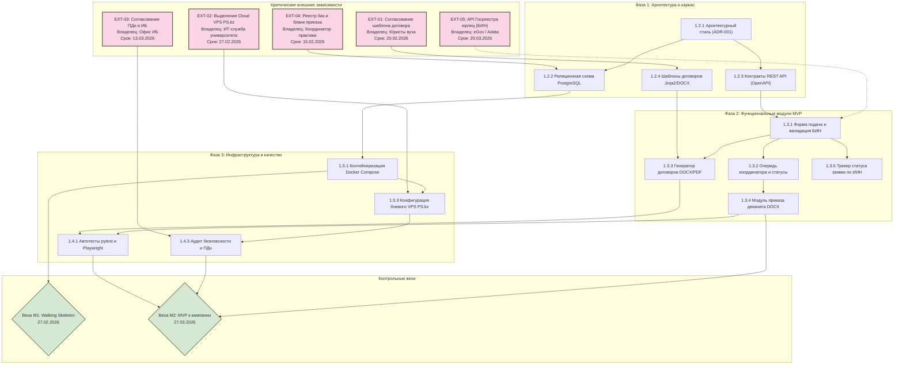

# Карта зависимостей проекта «Практика-Трекер»

**Проект**: Веб-сервис «Практика-Трекер»  
**Исполнитель**: Сәбитов Азамат (гр. АЖ-47, Solo PM & Full-cycle Developer)  
**Дисциплина**: Управление ИТ-проектами (Неделя 5, ЛЗ 5)  
**Связанный документ**: [ЛЗ 5. Сәбитов Азамат Аж-47.docx](file:///c:/Users/azama/Downloads/Шекербек%20лаб/ЛЗ%205.%20Сәбитов%20Азамат%20Аж-47.docx)

---

## 1. Сетевой граф зависимостей (Mermaid Dependency Map)

Диаграмма визуализирует внутренние технологические зависимости пакетов WBS и критические внешние блокирующие факторы, находящиеся в зоне ответственности внешних контрагентов.

---

## 2. Реестр внешних зависимостей (External Dependencies)

В соответствии с обязательным критерием выполнения лабораторной работы в проекте идентифицировано 5 ключевых внешних зависимостей с указанием владельца процесса, даты подтверждения и плана реагирования на риски:

| ID | Внешняя зависимость | Владелец (Ответственное лицо) | Дата подтверждения | Влияние на проект (Impact) | Риск и план реагирования при срыве срока |
|:---:|---|---|:---:|---|---|
| **EXT-01** | **Утверждение шаблона трехстороннего договора** и юридических формулировок по форме Приказа МОН РК № 107 | Юридический отдел вуза (Главный юрисконсульт) | **20 февраля 2026 г.** | **Блокирующее для пакета 1.3.3**: без согласования юристами генерация договоров юридически ничтожна | *План Б*: использование стандартного текста типового договора 2025 года с последующим патчем через Jinja2-шаблон без правки кода бэкенда. |
| **EXT-02** | **Выделение виртуального сервера (Cloud VPS)** и поддомена `praktika.enu.kz` в сети университета | Департамент цифровизации и ИТ-инфраструктуры | **27 февраля 2026 г.** | **Блокирующее для вехи M2**: невозможно развернуть публичный production-стенд | *План Б*: временный запуск на арендованном личном VPS в PS.kz (г. Алматы, тариф KZ-50) за 3 500 ₸/мес с последующим переносом на домен вуза. |
| **EXT-03** | **Согласование регламента обработки ПДн** (ИИН, телефоны) и модели угроз по Закону РК № 94-V | Офис информационной безопасности вуза | **13 марта 2026 г.** | **Блокирующее для сбора данных студентов**: риск предписания регулятора | *План Б*: проведение предрелизного аудита собственными силами по открытому ГОСТ/чек-листу ИБ, хранение базы в шифрованном томе LUKS. |
| **EXT-04** | **Передача архивного реестра баз практик** и официального бланка приказа деканата ФИТ | Координатор производственной практики кафедры ИС | **15 февраля 2026 г.** | **Влияет на пакеты 1.3.4 и 1.5.4**: задержка наполнения справочника компаний | *План Б*: ручной сбор топ-30 аккредитованных ИТ-компаний Астаны и Алматы из открытых источников и предыдущих приказов за 2025 год. |
| **EXT-05** | **Доступ к открытым реестрам юрлиц (БИН)** через eGov Open Data / Adata API | Внешний провайдер / Комитет госдоходов РК | **20 марта 2026 г.** | **Влияет на удобство автозаполнения (пакет 1.3.1)**: не блокирует базовый MVP | *План Б*: использование оффлайн-валидации контрольного разряда БИН по формуле КГД РК без синхронного сетевого запроса к eGov. |

---

## 3. Анализ критического пути (Critical Path Analysis)

Критический путь проекта проходит через следующую цепочку задач:
`EXT-04 (Архивные бланки) -> 1.2.4 (Шаблоны документов) -> EXT-01 (Виза юристов) -> 1.3.3 (Генератор договоров) -> 1.3.4 (Сводный приказ) -> EXT-02 (VPS) -> 1.4.3 (Аудит ИБ) -> Веха M2 (Go-Live)`.

Суммарная продолжительность критического пути составляет **6 недель**. Любая задержка по внешним зависимостям `EXT-01` или `EXT-02` непосредственно сдвигает дату старта весенней кампании практики, поэтому по ним предусмотрены заранее подготовленные компенсационные сценарии (План Б).
