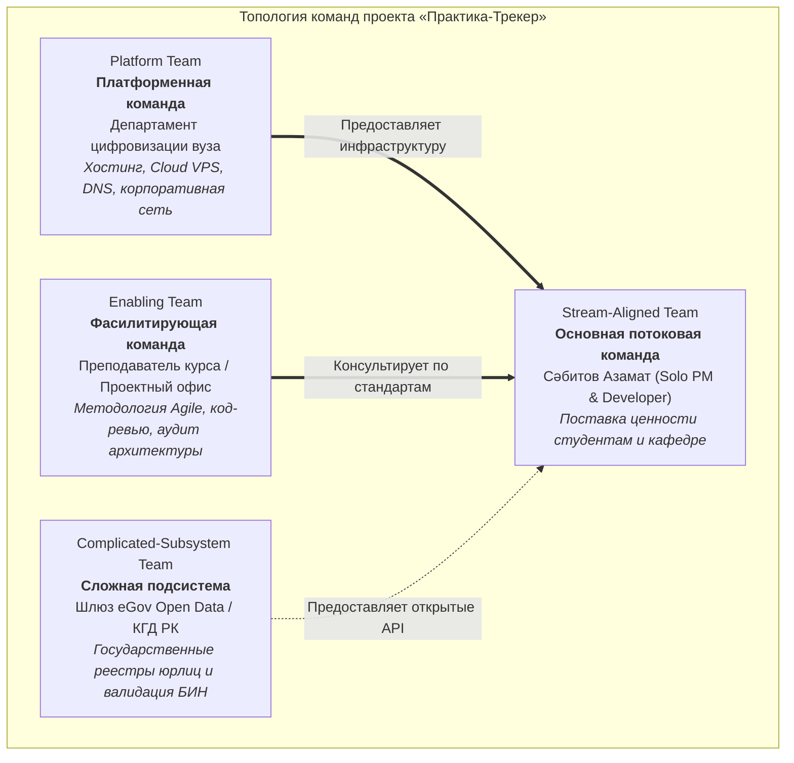

# Топология команд и матрица ответственности (RACI) проекта «Практика-Трекер»

**Проект**: Веб-сервис «Практика-Трекер»  
**Исполнитель**: Сәбитов Азамат (гр. АЖ-47, Solo PM & Full-cycle Developer)  
**Дисциплина**: Управление ИТ-проектами (Неделя 5, ЛЗ 5)  
**Связанный документ**: [ЛЗ 5. Сәбитов Азамат Аж-47.docx](file:///c:/Users/azama/Downloads/Шекербек%20лаб/ЛЗ%205.%20Сәбитов%20Азамат%20Аж-47.docx)

---

## 1. Топология команд проекта (Team Topologies)

В соответствии с современной методологией проектирования организационной структуры ИТ-систем **Team Topologies** (Мэтью Скелтон, Мануэль Пайс) проект «Практика-Трекер» взаимодействует со следующими четырьмя типами команд университетской и внешней экосистемы:

1. **Stream-Aligned Team (Потоковая команда)**:
   * **Состав**: Сәбитов Азамат (гр. АЖ-47).
   * **Миссия**: Непрерывная поставка сквозной ценности конечным пользователям (студентам и координатору практики). Команда обладает кросс-функциональной автономией и отвечает за весь жизненный цикл от сбора требований до эксплуатации.
2. **Platform Team (Платформенная команда)**:
   * **Субъект**: Департамент цифровизации и ИТ-инфраструктуры университета (ИТ-служба).
   * **Миссия**: Снижение когнитивной нагрузки потоковой команды за счет предоставления готовых инфраструктурных сервисов (Cloud VPS, поддомен `praktika.enu.kz`, доступ к внутренней сети вуза).
3. **Enabling Team (Обучающая / Фасилитирующая команда)**:
   * **Субъект**: Преподаватель дисциплины «Управление IT-проектами», кураторы курса.
   * **Миссия**: Передача методологических практик (WBS, INVEST, ISO 25010, Team Topologies), проведение регулярных контрольных проверок артефактов и архитектурных ревью.
4. **Complicated-Subsystem Team (Команда специализированной подсистемы)**:
   * **Субъект**: Внешние государственные шлюзы eGov и Комитета государственных доходов РК.
   * **Миссия**: Предоставление независимых внешних сервисов проверки статуса юридических лиц по БИН через REST API.

---

## 2. Модель распределения ролей индивидуального разработчика (Solo PM & Dev)

Поскольку проект выполняется в индивидуальном формате, все базовые инженерные и управленческие роли совмещаются одним исполнителем с четким разделением функциональных контекстов:

- **Project Manager (PM)**: Управление ожиданиями стейкхолдеров, контроль сроков и бюджета, фасилитация вех, приоритизация бэклога.
- **System Analyst (SA)**: Проведение CustDev-интервью, декомпозиция User Stories, спецификация 14 НФТ, составление WBS.
- **Fullstack Developer (DEV)**: Проектирование архитектуры FastAPI + PostgreSQL, верстка адаптивного веб-интерфейса, генерация DOCX/PDF.
- **QA Engineer (QA)**: Разработка модульных тестов pytest, сквозных сценариев Playwright, проведение нагрузочного тестирования k6.
- **DevOps / Security (OPS)**: Контейнеризация в Docker Compose, настройка CI/CD GitHub Actions, конфигурирование Cloud VPS, аудит ПДн.

---

## 3. Матрица ответственности RACI

Обозначения матричной ответственности:
- **R (Responsible — Исполнитель)**: Непосредственно выполняет работу по созданию артефакта.
- **A (Accountable — Подотчетный)**: Несет персональную ответственность за итоговое качество и приемку (только один A на строку!).
- **C (Consulted — Консультант)**: Предоставляет экспертные требования и согласует решения до их фиксации.
- **I (Informed — Информируемый)**: Уведомляется о факте готовности артефакта или смене его статуса.

| № | Ключевой проектный артефакт | Сәбитов А. (Solo PM/Dev) | Координатор практики | Зам. декана (Спонсор) | Юрист вуза | Офис ИБ | ИТ-служба вуза | Студенты 4 курса |
|:---:|---|:---:|:---:|:---:|:---:|:---:|:---:|:---:|
| 1 | Устав проекта (Project Charter) | **R** | C | **A** | I | I | I | I |
| 2 | Спецификация требований и бэклог | **R / A** | C | I | I | I | I | C |
| 3 | Шаблон трехстороннего договора | **R** | C | I | **A** | I | I | I |
| 4 | Регламент защиты ПДн и модель угроз | **R** | I | I | C | **A** | I | I |
| 5 | Конфигурация боевого сервера Cloud VPS | **R** | I | I | I | C | **A** | I |
| 6 | Исходный программный код системы | **R / A** | I | I | I | I | I | I |
| 7 | Отчеты тестирования и нагрузка k6 | **R / A** | I | I | I | I | I | I |
| 8 | Сводный проект приказа деканата в DOCX | **R** | C | **A** | I | I | I | I |
| 9 | Пользовательская инструкция и FAQ | **R / A** | C | I | I | I | I | I |
| 10 | Акт приемочных испытаний (UAT) и Go-Live | **R** | **A** | I | I | I | I | I |

### Анализ распределения матрицы RACI:
1. **Баланс ответственности**: Единственный разработчик (Сәбитов А.) выступает Исполнителем (**R**) по всем 10 артефактам, однако статус Подотчетного (**A**) разделен с ключевыми стейкхолдерами университета:
   * Зам. декана утверждает Устав и финальный Приказ деканата;
   * Юрист вуза единолично подотчетен за легитимность Шаблона договора;
   * Офис ИБ — за Защиту персональных данных;
   * Координатор практики — за подписание Акта UAT.
2. **Отсутствие конфликтов**: В каждой строке матрицы присутствует строго одно лицо со статусом **A**, что исключает размывание управленческой ответственности.
