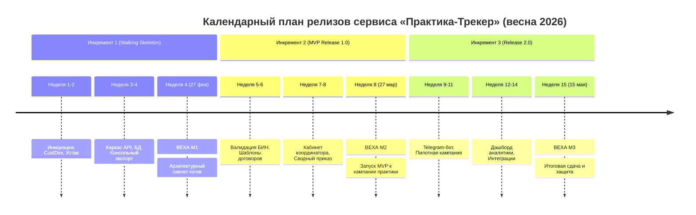

# План релизов на семестр проекта «Практика-Трекер»

**Проект**: Веб-сервис «Практика-Трекер»  
**Исполнитель**: Сәбитов Азамат (гр. АЖ-47, Solo PM & Full-cycle Developer)  
**Дисциплина**: Управление ИТ-проектами (Неделя 5, ЛЗ 5)  
**Связанный документ**: [ЛЗ 5. Сәбитов Азамат Аж-47.docx](file:///c:/Users/azama/Downloads/Шекербек%20лаб/ЛЗ%205.%20Сәбитов%20Азамат%20Аж-47.docx)

---

## 1. Концепция релизных инкрементов

Проект реализуется по итеративно-инкрементальной модели (Agile/Scrum с элементами Kanban-потока) в течение 15 учебных недель весеннего семестра 2026 года. Поставка функционала разделена на три логических инкремента:

---

## 2. Спецификация релизных инкрементов

### Инкремент 1: Walking Skeleton (Технический каркас) — Недели 1–4
- **Цель инкремента**: Развертывание базового сквозного каркаса архитектуры и верификация технологического стека (FastAPI, PostgreSQL, Docker) на ранней стадии.
- **Содержание (Scope)**:
  * Проектирование реляционной схемы данных (таблицы `students`, `companies`, `applications`);
  * Базовые REST-эндпоинты создания и чтения заявок без сложной валидации;
  * Простая HTML-форма для ввода контактных данных студента и наименования организации;
  * Консольный экспорт списка поступивших заявок в сырой CSV-формат.
- **Контрольная веха**: **M1 «Архитектурный каркас проверен»** (27 февраля 2026 г., конец Недели 4).
- **Критерии готовности (DoD вехи M1)**:
  1. Сервер бэкенда успешно запускается в Docker-контейнере и проходит health-check;
  2. База данных PostgreSQL инициализируется миграциями Alembic;
  3. Тестовая заявка успешно сохраняется в базе через веб-форму и доступна для чтения;
  4. Код покрыт базовыми смоук-тестами (pytest pass 100%).

---

### Инкремент 2: MVP (Release 1.0 — Основная поставка к кампании практики) — Недели 5–8
- **Цель инкремента**: Поставка полнофункционального минимально жизнеспособного продукта, готового к официальному старту сбора заявок на кафедре ИС ФИТ.
- **Содержание (Scope)**:
  * Алгоритмическая автовалидация БИН компаний по контрольному разряду КГД РК;
  * Серверная генерация юридически строгого трехстороннего договора в DOCX/PDF по типовой форме МОН РК № 107;
  * Рабочее место координатора практики с фильтрацией заявок по группам и сменой статусов («Согласовано» / «На доработке» с обязательным комментарием);
  * Пакетная генерация сводного проекта приказа деканата в формате DOCX;
  * Публичный веб-трекер статуса рассмотрения документов по ИИН студента;
  * Развертывание системы на боевом сервере Cloud VPS PS.kz с поддержкой HTTPS.
- **Контрольная веха**: **M2 «Готовность MVP к весенней кампании практики»** (27 марта 2026 г., конец Недели 8).
- **Критерии готовности (DoD вехи M2)**:
  1. Получено официальное согласование шаблона договора от юридического отдела вуза;
  2. Пройден приемочный пользовательский тест (UAT) координатором практики кафедры;
  3. Все 14 нефункциональных требований (НФТ) спецификации ЛЗ 4 верифицированы (p95 < 1.0 с, генерация PDF < 2.5 с);
  4. Развернут боевой стенд в ЦОД PS.kz с активным SSL-сертификатом и мониторингом Uptime Kuma;
  5. Сформирован и передан регламент работы для студентов и кураторов.

---

### Инкремент 3: Release 2.0 (Post-MVP стабилизация и расширение) — Недели 9–15
- **Цель инкремента**: Развитие сервиса по результатам пилотной эксплуатации, повышение удобства пользователей и подготовка итоговой проектной защиты.
- **Содержание (Scope)**:
  * Telegram-бот для моментального оповещения студентов об изменении статуса заявки;
  * Каталог аккредитованных компаний-партнеров кафедры с поиском и подсказками;
  * Интеграция с открытыми реестрами eGov Open Data для автоподтягивания наименований ТОО по БИН;
  * Аналитический дашборд покрытия практикой в разрезе специальностей и кафедр ФИТ;
  * Очистка технического долга, подготовка итогового эксплуатационного Runbook.
- **Контрольная веха**: **M3 «Завершение пилота и сдача проекта»** (15 мая 2026 г., конец Недели 15).
- **Критерии готовности (DoD вехи M3)**:
  1. В системе успешно обработано более 50 реальных договоров практики без сбоев;
  2. Проект приказа деканата автоматически сформирован и подписан деканом ФИТ;
  3. Достигнуты плановые бизнес-метрики: сокращение трудозатрат координатора с 18 до 2 ч/нед;
  4. Полный комплект проектной документации (ЛЗ 1–15) загружен в LMS и репозиторий GitHub.

---

## 3. Сводная таблица проектных вех (Milestones)

| Код вехи | Название контрольной вехи | Срок сдачи | Связанный инкремент | Ключевой результат (Deliverable) | Критерий успешности вехи |
|:---:|---|:---:|---|---|---|
| **M0** | Инициация и Project Charter | Неделя 2 (13.02) | Анализ и планирование | Устав проекта, матрица стейкхолдеров | Устав согласован со спонсором (Зав. кафедрой) |
| **M1** | Архитектурный каркас (Walking Skeleton) | Неделя 4 (27.02) | Инкремент 1 | Сквозной каркас API + БД в Docker | Сквозной сценарий «подача $\rightarrow$ сохранение $\rightarrow$ экспорт» работает |
| **M2** | Готовность MVP к кампании практики | Неделя 8 (27.03) | Инкремент 2 (MVP) | Сервис на VPS PS.kz, генератор DOCX/PDF | Координатор кафедры принял систему, виза юриста получена |
| **M3** | Завершение пилота и защита проекта | Неделя 15 (15.05) | Инкремент 3 (Release 2.0) | Работающий сервис, Telegram-бот, Runbook | Успешная обработка потока практики, сдача портфолио в LMS |
