# Иерархическая структура работ (WBS) проекта «Практика-Трекер»

**Проект**: Веб-сервис автоматизации распределения производственной практики «Практика-Трекер»  
**Исполнитель**: Сәбитов Азамат (гр. АЖ-47, Solo PM & Full-cycle Developer)  
**Дисциплина**: Управление ИТ-проектами (Неделя 5, ЛЗ 5)  
**Связанный документ**: [ЛЗ 5. Сәбитов Азамат Аж-47.docx](file:///c:/Users/azama/Downloads/Шекербек%20лаб/ЛЗ%205.%20Сәбитов%20Азамат%20Аж-47.docx)

---

## 1. Иерархическая структура работ WBS (3 уровня декомпозиции)

```mermaid
graph TD
    WBS["1.0 Веб-сервис «Практика-Трекер»"]
    
    WBS --> P1["1.1 Управление и аналитика"]
    WBS --> P2["1.2 Архитектура и проектирование"]
    WBS --> P3["1.3 Разработка функционала (Core)"]
    WBS --> P4["1.4 Тестирование и безопасность"]
    WBS --> P5["1.5 Инфраструктура и DevOps"]
    WBS --> P6["1.6 Внедрение и эксплуатация"]
    
    P1 --> P11["1.1.1 Устав и матрица стейкхолдеров"]
    P1 --> P12["1.1.2 Исследования CustDev (JTBD)"]
    P1 --> P13["1.1.3 Спецификация требований и НФТ"]
    P1 --> P14["1.1.4 Календарный план и WBS"]
    
    P2 --> P21["1.2.1 Архитектурный стиль (ADR-001)"]
    P2 --> P22["1.2.2 Реляционная схема PostgreSQL"]
    P2 --> P23["1.2.3 Спецификация REST API (OpenAPI)"]
    P2 --> P24["1.2.4 Шаблоны договоров Jinja2/DOCX"]
    
    P3 --> P31["1.3.1 Модуль подачи и валидации БИН"]
    P3 --> P32["1.3.2 Очередь координатора и статусы"]
    P3 --> P33["1.3.3 Серверный генератор договоров"]
    P3 --> P34["1.3.4 Модуль формирования приказа"]
    P3 --> P35["1.3.5 Онлайн-трекер статуса по ИИН"]
    
    P4 --> P41["1.4.1 Модульные тесты pytest"]
    P4 --> P42["1.4.2 E2E сценарии Playwright"]
    P4 --> P43["1.4.3 Аудит безопасности и ПДн"]
    P4 --> P44["1.4.4 Нагрузочный бенчмарк k6"]
    
    P5 --> P51["1.5.1 Контейнеризация Docker Compose"]
    P5 --> P52["1.5.2 CI/CD в GitHub Actions"]
    P5 --> P53["1.5.3 Конфигурация Cloud VPS PS.kz"]
    P5 --> P54["1.5.4 Миграция архивных баз Excel"]
    
    P6 --> P61["1.6.1 Пользовательские регламенты"]
    P6 --> P62["1.6.2 Пилотный запуск на кафедре ИС"]
    P6 --> P63["1.6.3 Ретроспектива и сдача деканату"]
```

---

## 2. Сводный реестр пакетов работ WBS

| Код WBS | Наименование пакета работ | Уровень | Оценка трудоемкости (ч) | Результат (Deliverable) |
|---|---|:---:|:---:|---|
| **1.0** | **Веб-сервис «Практика-Трекер»** | 1 | **100 ч** | Работающая система автоматизации практики |
| **1.1** | **Управление проектом и требования** | 2 | **14 ч** | Согласованный базовый скоуп и план проекта |
| 1.1.1 | Устав проекта и анализ стейкхолдеров | 3 | 3 ч | Project Charter, матрица «Влияние — Интерес» |
| 1.1.2 | Проблемные CustDev-интервью (JTBD) | 3 | 3 ч | Протоколы 2 интервью, продуктовые инсайты |
| 1.1.3 | Спецификация бэклога и НФТ (ISO 25010) | 3 | 5 ч | User Story Map, бэклог 18 историй, 14 НФТ |
| 1.1.4 | Календарное планирование, WBS и capacity | 3 | 3 ч | WBS, словарь WBS, план релизов, RACI, расчет capacity |
| **1.2** | **Архитектура и проектирование** | 2 | **12 ч** | Архитектурный каркас и спецификации данных |
| 1.2.1 | Разработка архитектурного решения (ADR-001) | 3 | 3 ч | Документ ADR-001, обоснование стека и архитектуры |
| 1.2.2 | Проектирование схемы базы данных PostgreSQL | 3 | 3 ч | ER-диаграмма, DDL-скрипты миграций Alembic |
| 1.2.3 | Спецификация контрактов API (OpenAPI 3.0) | 3 | 3 ч | Swagger-схема эндпоинтов, DTO-модели Pydantic |
| 1.2.4 | Разработка шаблонов документов (DOCX/PDF) | 3 | 3 ч | Шаблоны Jinja2/python-docx трехстороннего договора |
| **1.3** | **Разработка функциональных модулей (Core)** | 2 | **40 ч** | Программный код системы (FastAPI + Web UI) |
| 1.3.1 | Модуль веб-формы подачи и валидации БИН | 3 | 8 ч | Экран подачи, валидатор контрольного разряда БИН |
| 1.3.2 | Модуль очереди координатора и смены статусов | 3 | 8 ч | Дашборд заявок, ролевые фильтры, смена статусов |
| 1.3.3 | Серверный модуль генерации договоров | 3 | 8 ч | Сервис автосборки DOCX/PDF по реквизитам сторон |
| 1.3.4 | Модуль сводного проекта приказа деканата | 3 | 10 ч | Алгоритм агрегации по базам, экспорт приказа DOCX |
| 1.3.5 | Публичный трекер статуса заявки по ИИН | 3 | 6 ч | Веб-виджет проверки статуса, генератор ссылок |
| **1.4** | **Тестирование и информационная безопасность** | 2 | **14 ч** | Отчеты тестирования и защищенность системы |
| 1.4.1 | Модульное и интеграционное тестирование | 3 | 5 ч | Набор автотестов pytest (покрытие бизнес-логики > 80%) |
| 1.4.2 | Сквозное e2e-тестирование сценариев | 3 | 3 ч | Тесты Playwright (подача заявки, аппрув, генерация) |
| 1.4.3 | Аудит безопасности и соблюдения норм ПДн | 3 | 3 ч | Проверка gitleaks, trivy, чек-лист Закона РК № 94-V |
| 1.4.4 | Нагрузочное тестирование производительности | 3 | 3 ч | Скрипты k6, отчет проверки p95 < 1.0 с при 50 VU |
| **1.5** | **Инфраструктура, DevOps и миграция** | 2 | **11 ч** | Развернутая рабочая среда и непрерывная сборка |
| 1.5.1 | Контейнеризация и оркестрация стека | 3 | 3 ч | Dockerfile, docker-compose.yml (FastAPI, Postgres, Nginx) |
| 1.5.2 | Настройка CI/CD-пайплайна автоматизации | 3 | 3 ч | GitHub Actions workflow: линтинг, автотесты, сборка |
| 1.5.3 | Конфигурация боевого сервера Cloud VPS PS.kz | 3 | 3 ч | Настройка Ubuntu 22.04, SSL Let's Encrypt, Uptime Kuma |
| 1.5.4 | Скрипт миграции архивных данных из Excel | 3 | 2 ч | Скрипт seed_companies.py, первичное наполнение БД |
| **1.6** | **Внедрение, апробация и сдача проекта** | 2 | **9 ч** | Ввод в эксплуатацию и учебные артефакты |
| 1.6.1 | Подготовка пользовательской документации | 3 | 3 ч | Инструкция для координатора, памятка студента |
| 1.6.2 | Пилотная эксплуатация на кафедре ИС | 3 | 3 ч | Обработка 50 реальных заявок весенней кампании |
| 1.6.3 | Ретроспектива и итоговая защита проекта | 3 | 3 ч | Отчет по метрикам, презентация и защита перед деканатом |

---

## 3. Словарь WBS (WBS Dictionary) для 5 ключевых пакетов работ

### Пакет 1.3.1: Модуль веб-формы подачи заявки и валидации БИН
- **Код WBS**: 1.3.1
- **Ответственный**: Сәбитов Азамат (Frontend / Fullstack Developer)
- **Цель и описание**: Разработка адаптивного веб-интерфейса для ввода данных студента (ФИО, ИИН, академическая группа, телефон) и реквизитов организации (наименование, 12-значный БИН, юридический адрес, контакты куратора от предприятия).
- **Входные данные**: Макет экранной формы, алгоритм расчета контрольного разряда БИН по формуле КГД РК.
- **Выходные артефакты**: Исходный код экранной формы, клиентский и серверный валидаторы БИН, DTO-схема Pydantic.
- **Критерии готовности (DoD)**:
  1. Форма корректно валидирует 12-значный формат ИИН/БИН;
  2. БИН с неверным контрольным разрядом блокирует отправку с понятным сообщением об ошибке;
  3. Успешная отправка сохраняет черновик заявки в PostgreSQL и возвращает токен отслеживания;
  4. Форма адаптирована для экранов от 360 px (тестирование на смартфонах).
- **Трудоемкость**: 8 часов.
- **Зависимости**: Зависит от пакета 1.2.2 (схема БД) и 1.2.3 (API-контракты).

---

### Пакет 1.3.3: Серверный модуль генерации договоров
- **Код WBS**: 1.3.3
- **Ответственный**: Сәбитов Азамат (Backend Developer)
- **Цель и описание**: Разработка бэкенд-сервиса автоматического формирования юридически выверенного трехстороннего договора в форматах DOCX и PDF на основе согласованного шаблона Jinja2 и python-docx.
- **Входные данные**: Утвержденная типовая форма договора МОН РК № 107, реквизиты вуза, валидированные данные компании и студента.
- **Выходные артефакты**: Сервисный модуль `document_service.py`, шаблон `contract_template.docx`, генератор PDF `weasyprint/docx2pdf`.
- **Критерии готовности (DoD)**:
  1. Генерация договора выполняется за время не более 2.5 секунд (p90);
  2. 100% текстовых полей соответствуют типовой форме, утвержденной юристами вуза;
  3. Генерируемый документ открывается без искажений разметки в MS Word 2016+ и LibreOffice;
  4. Файл автоматически прикрепляется к карточке заявки и доступен для скачивания по защищенному URL.
- **Трудоемкость**: 8 часов.
- **Зависимости**: Зависит от 1.2.4 (согласованный шаблон договора) и 1.3.1 (данные заявки).

---

### Пакет 1.3.4: Модуль формирования проекта приказа деканата
- **Код WBS**: 1.3.4
- **Ответственный**: Сәбитов Азамат (Backend Developer)
- **Цель и описание**: Создание сервиса пакетной агрегации согласованных заявок студентов по специальностям и курсам с генерацией единого сводного проекта приказа декана в формате DOCX.
- **Входные данные**: Реестр заявок со статусом «Согласовано», шаблон бланка приказа деканата ФИТ.
- **Выходные артефакты**: Модуль `order_generator.py`, экран выгрузки приказа в панели координатора.
- **Критерии готовности (DoD)**:
  1. Студенты в приказе сгруппированы по базам практики и упорядочены по алфавиту;
  2. По каждой базе указаны сроки практики, специальность, академическая группа и руководитель;
  3. Студенты со статусом «Не распределен» автоматически исключаются с выводом алерта координатору;
  4. Время сборки документа на 250 студентов не превышает 3.5 секунд.
- **Трудоемкость**: 10 часов.
- **Зависимости**: Зависит от 1.3.2 (очередь координатора) и 1.2.4 (шаблоны документов).

---

### Пакет 1.4.3: Аудит информационной безопасности и соответствия нормам ПДн
- **Код WBS**: 1.4.3
- **Ответственный**: Сәбитов Азамат (Security / DevOps)
- **Цель и описание**: Проведение комплексного аудита защищенности веб-сервиса, предотвращение утечек персональных данных студентов (ИИН, номера удостоверений, телефоны) и обеспечение соответствия Закону РК «О персональных данных и их защите» № 94-V.
- **Входные данные**: Исходный код проекта, модель угроз, чек-лист требований информационной безопасности вуза.
- **Выходные артефакты**: Протокол аудита безопасности, отчет сканирования уязвимостей, чек-лист соответствия Закону РК № 94-V.
- **Критерии готовности (DoD)**:
  1. Пароли пользователей хешируются исключительно с солью (Argon2id/bcrypt, cost >= 12);
  2. В Git-репозитории отсутствуют секреты и токены (проверка gitleaks проходит с 0 замечаний);
  3. Прямой доступ к чужим заявкам по ID заблокирован (автотест возвращает HTTP 403 Forbidden);
  4. Сервер и БД физически размещены в дата-центре на территории Республики Казахстан (Cloud VPS PS.kz, г. Алматы).
- **Трудоемкость**: 3 часа.
- **Зависимости**: Зависит от 1.3.1–1.3.5 (код модулей) и 1.5.1 (контейнеризация).

---

### Пакет 1.5.3: Конфигурация боевого сервера Cloud VPS PS.kz
- **Код WBS**: 1.5.3
- **Ответственный**: Сәбитов Азамат (DevOps Engineer)
- **Цель и описание**: Развертывание и базовая настройка виртуального выделенного сервера на базе Ubuntu 22.04 LTS в казахстанском дата-центре PS.kz, настройка обратного прокси Nginx, генерация SSL-сертификатов Let's Encrypt и мониторинга Uptime Kuma.
- **Входные данные**: Доступ к VPS (2 vCPU, 4 GB RAM, 50 GB SSD), доменное имя сервиса, конфигурации Docker Compose.
- **Выходные артефакты**: Настроенный production-сервер, скрипты развертывания, дашборд мониторинга Uptime Kuma.
- **Критерии готовности (DoD)**:
  1. Сервер доступен по защищенному протоколу HTTPS (TLS 1.3, рейтинг SSL Labs A/A+);
  2. Контейнеры поднимаются командой `docker compose up -d` с автоматическим перезапуском (`restart: always`);
  3. Настроен ежедневный автоматический cron-дамп БД PostgreSQL в изолированный каталог с ротацией 30 дней;
  4. Внешний health-check мониторинг фиксирует аптайм с интервалом опроса 60 секунд.
- **Трудоемкость**: 3 часа.
- **Зависимости**: Зависит от 1.5.1 (Docker Compose) и внешнего согласования сервера с ИТ-отделом.
