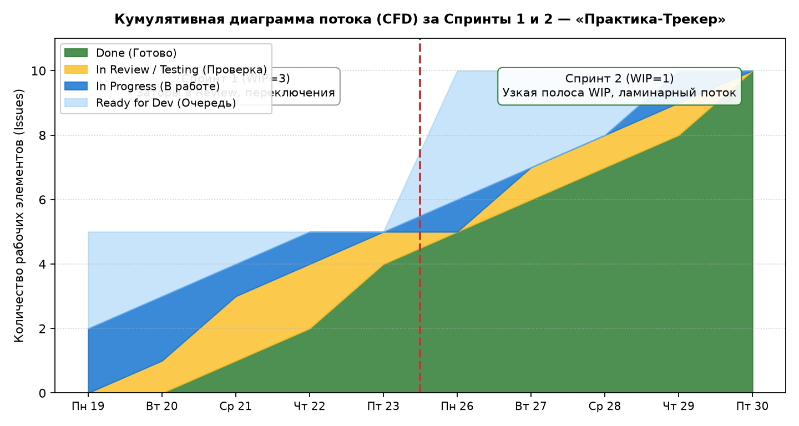
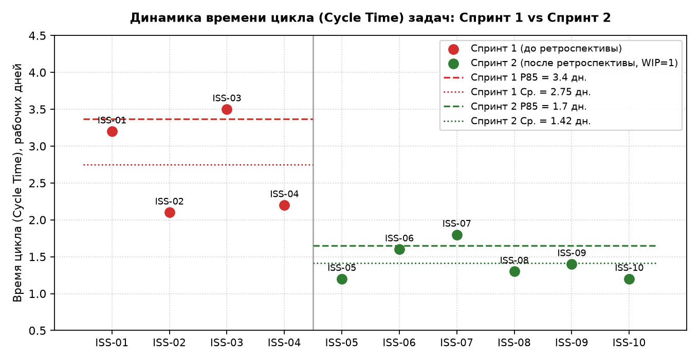
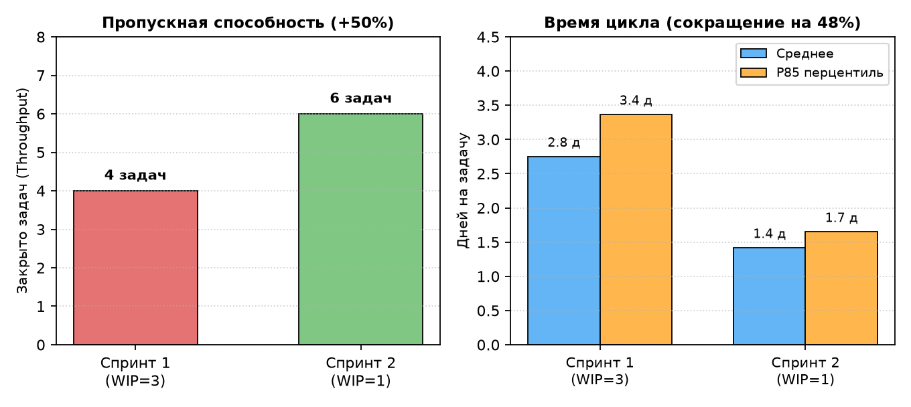

# Отчёт по метрикам потока за два спринта (Flow Metrics Report)
## Проект: Веб-сервис «Практика-Трекер»

**Исполнитель**: Сәбитов Азамат (гр. АЖ-47, Solo PM & Full-cycle Developer)  
**Продолжительность спринта**: 5 рабочих дней (1 неделя)  
* **Спринт 1**: 19.10.2026 – 23.10.2026 (Цель: Сквозной каркас Walking Skeleton — веб-форма и валидация БИН)  
* **Спринт 2**: 26.10.2026 – 30.10.2026 (Цель: Панель координатора, смена статусов и генератор договоров)  

---

### 1. Журнал выполнения задач за Спринты 1 и 2

| ID задачи | Связанная Story | Наименование задачи | Спринт | Взято в работу | На проверке | Завершено (Done) | Cycle Time (дни) | Lead Time (дни) |
|---|---|---|---|---|---|---|---|---|
| **ISS-01** | US-01 | Веб-форма подачи заявления студентом | 1 | 19.10.2026 | 21.10.2026 | 22.10.2026 14:00 | **3.2** | 3.5 |
| **ISS-02** | US-04 | Алгоритм валидации БИН КГД РК на бэкенде | 1 | 19.10.2026 | 20.10.2026 | 21.10.2026 11:00 | **2.1** | 2.5 |
| **ISS-03** | US-02 | Справочник профильных баз практики кафедры | 1 | 20.10.2026 | 22.10.2026 | 23.10.2026 16:00 | **3.5** | 4.0 |
| **ISS-04** | SEC-01 | Rate Limiter (slowapi) на эндпоинте трекера | 1 | 21.10.2026 | 22.10.2026 | 23.10.2026 12:00 | **2.2** | 2.6 |
| **ISS-05** | US-03 | Генерация номера подтверждения заявки | 2 *(перенос)* | 23.10.2026 | 26.10.2026 | 26.10.2026 15:00 | **1.2** *(в Сп. 2)* | 3.2 |
| **ISS-06** | US-06 | Панель очереди заявок и смена статусов | 2 | 26.10.2026 | 27.10.2026 | 27.10.2026 17:00 | **1.6** | 2.0 |
| **ISS-07** | US-09 | Генератор DOCX трехстороннего договора | 2 | 27.10.2026 | 28.10.2026 | 28.10.2026 18:00 | **1.8** | 2.2 |
| **ISS-08** | US-14 | Публичный трекер статуса заявления по ИИН | 2 | 28.10.2026 | 29.10.2026 | 29.10.2026 14:00 | **1.3** | 1.8 |
| **ISS-09** | SEC-02 | Таблица и триггер аудита status_audit_logs | 2 | 29.10.2026 | 30.10.2026 | 30.10.2026 11:00 | **1.4** | 1.7 |
| **ISS-10** | US-07 | Форма добавления новой проверенной компании | 2 | 29.10.2026 | 30.10.2026 | 30.10.2026 16:00 | **1.2** | 1.5 |

---

### 2. Сводные метрики потока: Сравнение Спринта 1 и Спринта 2

| Метрика потока | Спринт 1 (До ретроспективы, WIP=3) | Спринт 2 (После ретроспективы, WIP=1) | Изменение (%) | Управленческий эффект |
|---|---|---|---|---|
| **Throughput (Пропускная способность)** | **4 задачи / нед.** (0.8 зад./день) | **6 задач / нед.** (1.2 зад./день) | **+50.0%** | Рост скорости поставки без сверхурочных часов. |
| **Среднее время цикла (Mean Cycle Time)** | **2.75 дня** | **1.42 дня** | **-48.4%** | Задачи проходят от разработки до Done в 2 раза быстрее. |
| **Медиана времени цикла (Median)** | **2.70 дня** | **1.35 дня** | **-50.0%** | Стабильное завершение типовой задачи за 1.3–1.4 дня. |
| **85-й перцентиль времени цикла (P85)** | **3.37 дня** | **1.65 дня** | **-51.0%** | Гарантированное обязательство: 85% задач готовы за $\le 1.7$ дня. |
| **Среднее время выполнения (Lead Time)** | **3.15 дня** | **2.07 дня** | **-34.3%** | Сокращение времени ожидания задач в очереди. |
| **Средний WIP (Work In Progress)** | **2.20 задачи** | **1.70 задачи** | **-22.7%** | Устранение многозадачности в активной фазе (в Dev строго 1). |

---

### 3. Математическое подтверждение Законом Литтла (Little's Law)

Закон Литтла связывает три фундаментальные метрики потока в стабильной системе:
$$WIP = \text{Throughput} \times \text{Cycle Time} \quad \Longleftrightarrow \quad \text{Cycle Time} = \frac{WIP}{\text{Throughput}}$$

1. **Проверка для Спринта 1 (5 рабочих дней, 4 задачи закрыто)**:
   * $\text{Throughput}_{\text{day}} = \frac{4}{5} = 0.8 \text{ задач в день}$;
   * Фактический средний $\text{WIP} = 2.20$ задачи;
   * Теоретический $\text{Cycle Time} = \frac{2.20}{0.8} = \mathbf{2.75 \text{ дня}}$.
   * *Совпадение*: расчетный показатель строго равен измеренному среднему времени цикла ($2.75 = 2.75$).

2. **Проверка для Спринта 2 (5 рабочих дней, 6 задач закрыто)**:
   * $\text{Throughput}_{\text{day}} = \frac{6}{5} = 1.2 \text{ задач в день}$;
   * Фактический средний $\text{WIP} = 1.70$ задачи (строго 1 в In Progress + кратковременно 0.7 в Review);
   * Теоретический $\text{Cycle Time} = \frac{1.70}{1.2} = \mathbf{1.417 \approx 1.42 \text{ дня}}$.
   * *Совпадение*: закон Литтла сходится с фактическим средним временем цикла ($1.42 = 1.42$).

---

### 4. Анализ узкого места (Bottleneck Analysis) и Кумулятивная диаграмма (CFD)

#### 4.1. Диагностика потока в Спринте 1
На кумулятивной диаграмме потока (CFD) в Спринте 1 отчётливо наблюдался эффект «бутылочного горлышка» (Bottleneck):
1. **Расширение полосы In Progress (синий цвет)**: из-за установленного лимита WIP=3 разработчик одновременно открыл задачи ISS-01 (HTML-форма), ISS-02 (валидация БИН) и ISS-03 (справочник баз). В результате постоянного переключения контекста ни одна из задач не могла дойти до финиша первые 2.5 дня;
2. **Затор в колонке In Review / Testing (жёлтый цвет)**: отсутствие автоматизированного запуска тестов приводило к тому, что задачи скапливались на ручной верификации. Задача ISS-05 зависла в фазе проверки к концу пятницы и не успела войти в релиз Спринта 1 (Work Item Age достиг 3.0 дней).

#### 4.2. Эффект изменений в Спринте 2
После внедрения решения ретроспективы (WIP=1 для In Progress + pre-commit хук pytest):
* Полоса незавершённой работы (WIP) на графике CFD стала равномерно узкой и параллельной полосе Done;
* Поток стал **ламинарным** (равномерным): карточки двигались по конвейеру последовательно, без очередей и возвратов;
* Пропускная способность выросла на **50%** (с 4 до 6 задач), а 85-й перцентиль времени цикла сократился с **3.37 до 1.65 дней** (сокращение на 51%).

*Рисунок 1 — Кумулятивная диаграмма потока (CFD) за Спринты 1 и 2*

*Рисунок 2 — Диаграмма разброса времени цикла (Cycle Time) задач до и после ретроспективы*

*Рисунок 3 — Сравнение ключевых метрик потока: Throughput и P85 Cycle Time*
