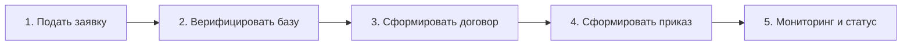

# Карта пользовательских историй (User Story Map) проекта «Практика-Трекер»

**Проект**: «Практика-Трекер» (веб-сервис автоматизации производственной практики)  
**Исполнитель**: Сәбитов Азамат (гр. АЖ-47, Solo PM & Developer)  
**Методология**: Jeff Patton User Story Mapping  
**Связанный документ**: [ЛЗ 4. Сәбитов Азамат Аж-47.docx](file:///c:/Users/azama/Downloads/Шекербек%20лаб/ЛЗ%204.%20Сәбитов%20Азамат%20Аж-47.docx)

---

## 1. Сквозной пользовательский сценарий (Backbone)

---

## 2. Матрица релизных срезов User Story Map

| Шаг сценария | 1. Подать заявку | 2. Верифицировать базу | 3. Сформировать договор | 4. Сформировать приказ | 5. Мониторинг и статус |
|---|---|---|---|---|---|
| **MVP (релиз 1–2 / Walking Skeleton)** | Веб-форма с типом базы и обязательными полями (ФИО, ИИН, телефон, БИН) | Автопроверка контрольного разряда БИН; очередь заявок координатора; ручная смена статуса | Автогенерация типового трехстороннего договора в DOCX/PDF по шаблону МОН РК | Сводный реестр согласованных заявок; генерация проекта приказа деканата в DOCX | Проверка статуса по ИИН; базовый дашборд координатора; выгрузка реестра в CSV |
| **Версия 2** | Выбор компании из каталога партнеров; загрузка скана гарантийного письма | Проверка дублей по ИИН; интеграция с Adata/eGov для автоподтягивания наименования ТОО | Загрузка подписанного скана студентом; предпросмотр PDF-файла в браузере | Конструктор шаблонов приказов по кафедрам; исключение нераспределенных студентов | Telegram-уведомления об изменении статуса; дашборд задолжников с напоминаниями |
| **Версия 3 и дальше** | Вход через корпоративный аккаунт вуза (Google Workspace / SSO) | Прямое электронное согласование практики с HR-отделом предприятия через портал | Двусторонняя цифровая подпись договора через ЭЦП / QR-код eGov Mobile | Прямая отправка утвержденного приказа в систему электронного документооборота (Documentolog) | Аналитический модуль трудоустройства выпускников по итогам практики за 3 года |

---

## 3. Обоснование выбора Walking Skeleton

Срез MVP выбран так, чтобы сквозной пользовательский путь работал целиком:
1. Студент подал заявку с БИН;
2. Система проверила БИН по алгоритму КГД РК;
3. Координатор одобрил заявку;
4. Договор сгенерирован автоматически;
5. Проект приказа собран в единый DOCX;
6. Статус отображается в онлайн-реестре.

Это классический **Walking Skeleton**: тонкий, но сквозной вертикальный срез через всю архитектуру. Альтернативный вариант («сначала запрограммировать все экранные формы подачи и профили студентов, а генерацию договоров оставить на потом») категорически отвергнут — он не решает главную задачу деканата и дает демонстрируемый результат только к концу семестра.
