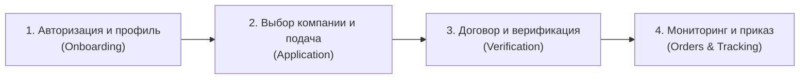

# Карта пользовательских историй (User Story Map) проекта «Практика-Трекер»

**Проект**: «Практика-Трекер»  
**Исполнитель**: Азамат (Solo PM & Developer)  
**Методология**: Jeff Patton User Story Mapping

---

## 1. Сквозной пользовательский сценарий (Backbone)

---

## 2. Матрица релизных срезов

| Срез релиза | 1. Авторизация и профиль | 2. Выбор компании и подача | 3. Договор и верификация | 4. Мониторинг и приказ |
|---|---|---|---|---|
| **Срез 1: Walking Skeleton** *(Каркас системы, неделя 4)* | Базовая форма входа (email/password), сохранение сессии в JWT. | Ввод названия компании и адреса в простую форму без справочников. | Загрузка PDF-файла на диск сервера, сохранение пути в PostgreSQL. | Консольная выгрузка списка заявок в сырой CSV-файл через API. |
| **Срез 2: MVP (Release 1.0)** *(Основная поставка к кампании, недели 8–10)* | Регистрация по почте `@enu.kz`, профиль студента (ФИО, группа, специальность), RBAC (Студент / Координатор / Деканат). | Справочник аккредитованных компаний; ввод БИН новой компании с валидацией контрольного разряда; данные руководителя. | Автогенерация договора в PDF по шаблону МОН РК; загрузка подписанного скана; смена статусов координатором с комментарием. | Дашборд координатора со сводной статистикой; фильтры по группам и статусам; экспорт сводного приказа в DOCX и Excel. |
| **Срез 3: Release 2.0** *(Post-MVP развитие)* | Вход через Google Workspace университета (OAuth 2.0); двухфакторная аутентификация (2FA). | Автозаполнение реквизитов компаний через интеграцию с eGov Open Data по БИН; каталог отзывов о практиках. | Двусторонняя цифровая верификация договора через OTP / SMS-код компании; пакетный экспорт сканов в zip-архив. | Telegram-бот для моментальных пуш-уведомлений о дедлайнах и смене статусов; аналитика трудоустройства выпускников. |
