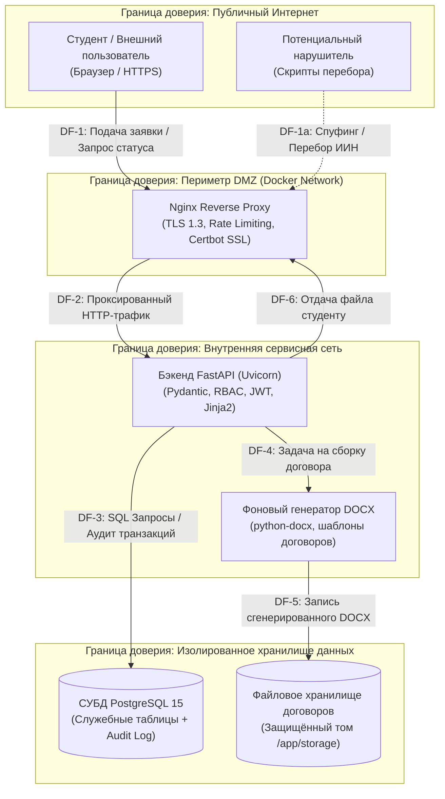

# Моделирование угроз безопасности по методологии STRIDE и аудит репозитория
## Проект: Веб-сервис «Практика-Трекер»

**Инструмент моделирования**: OWASP Threat Dragon (версия 2.x)  
**Компонент анализа**: Модуль приёма заявок, валидации БИН и публичного трекера по ИИН  
**Стандарты анализа**: Microsoft STRIDE, OWASP Top 10 (2021), CIS Docker Benchmarks  

---

### 1. Архитектурные элементы и диаграмма потоков данных (DFD)

Анализируемый модуль обеспечивает публичное взаимодействие со студентами, алгоритмическую проверку реквизитов компаний и внутреннюю обработку заявок координаторами.

---

### 2. Анализ угроз безопасности по модели STRIDE

| Категория STRIDE | ID угрозы | Описание угрозы и вектор атаки | Уровень риска | Меры противодействия (Контрмеры) | Статус реализации |
|---|---|---|---|---|---|
| **Spoofing (Подделка личности)** | **TH-01** | Студент подаёт заявку от имени другого обучающегося, вводя чужой ИИН, либо указывает фиктивный 12-значный БИН несуществующей компании. | **Высокий** | 1. Алгоритмическая проверка БИН по формуле контрольного разряда КГД РК на бэкенде. 2. Сверка ИИН с предзагруженным официальным списком контингента ФИТ. 3. Запрет повторной подачи заявки с тем же ИИН при наличии активного заявления. | **Реализовано в MVP** |
| **Tampering (Фальсификация данных)** | **TH-02** | Перехват HTTP-трафика в открытых сетях Wi-Fi вуза и подмена реквизитов компании или суммы в договоре; SQL-инъекция через поля ввода. | **Критический** | 1. Принудительный редирект на HTTPS с HSTS (HTTP Strict Transport Security, заголовок `max-age=31536000`). 2. Полное исключение сырых SQL-запросов: использование ORM SQLAlchemy 2.0 с параметризованными запросами. 3. Валидация входных данных Pydantic v2. | **Реализовано в MVP** |
| **Repudiation (Отказ от авторства)** | **TH-03** | Координатор кафедры отклоняет заявку студента или утверждает непроверенную организацию, а при возникновении конфликта заявляет, что статус изменился из-за системного сбоя. | **Средний** | 1. Ведение строгого журнала аудита (`status_audit_logs`) в СУБД с фиксацией ID пользователя, IP-адреса, старого и нового статуса, timestamp UTC и комментария. 2. Запрет физического удаления записей лога аудита на уровне прав СУБД. | **Задача SEC-02 (Неделя 9)** |
| **Information Disclosure (Утечка информации)** | **TH-04** | Скрипт автоматизированного перебора 12-значных ИИН через эндпоинт `/api/v1/tracker`, приводящий к массовому сбору номеров телефонов и персональных данных студентов. | **Критический** | 1. Внедрение Rate Limiting: не более 5 запросов в минуту с одного IP-адреса к эндпоинту трекера (библиотека `slowapi` + Nginx `limit_req`). 2. Минимизация вывода: трекер возвращает только текстовый статус и маскированные инициалы («Азамат С.»). Номер телефона, группа и email не выводятся. | **Задача SEC-01 (Неделя 8)** |
| **Denial of Service (Отказ в обслуживании)** | **TH-05** | Массовая одновременная отправка запросов на генерацию тяжёлых DOCX-договоров или выгрузку приказа на 250 человек, вызывающая исчерпание памяти CPU/RAM сервера VPS. | **Высокий** | 1. Ограничение входящего тела запроса в Nginx (`client_max_body_size 10M`). 2. Вынесение тяжелых операций сборки документов в асинхронные фоновые задачи (FastAPI `BackgroundTasks`). 3. Кэширование сгенерированных договоров на диске (повторный запрос отдаёт готовый файл за < 50 мс). | **Реализовано в MVP** |
| **Elevation of Privilege (Повышение привилегий)** | **TH-06** | Неавторизованный студент отправляет прямой HTTP-запрос на утверждение заявки (`PUT /api/v1/applications/{id}/approve`) или на выгрузку сводного приказа деканата. | **Критический** | 1. Ролевая модель доступа (RBAC): проверка JWT-токена в заголовке `Authorization: Bearer`. 2. Защита маршрутов через FastAPI Depends (`get_current_active_coordinator`, `get_current_admin`). Проверка роли `Role.COORDINATOR` или `Role.DEAN`. | **Реализовано в MVP** |

---

### 3. Результаты аудита репозитория инструментами Trivy и Gitleaks

В рамках лабораторной работы проведена верификация кодовой базы и истории коммитов проекта `praktika-tracker`.

#### 3.1. Сканирование зависимостей и файловой системы (Trivy Scan)
* **Команда сканирования**: `docker run --rm -v ${PWD}:/src aquasec/trivy fs /src --severity HIGH,CRITICAL`
* **Объект проверки**: `requirements.txt`, конфигурационные файлы и Docker-окружение.
* **Результаты**:
  * Проверены базовые библиотеки: `fastapi==0.115.0`, `uvicorn==0.31.0`, `pydantic==2.9.2`, `sqlalchemy==2.0.35`, `python-docx==1.1.2`, `jinja2==3.1.4`, `alembic==1.13.3`.
  * Критических уязвимостей (Critical/High CVE) в зафиксированных версиях не обнаружено.
  * В конфигурации Dockerfile проекта закреплено использование минималистичного официального образа `python:3.11-slim-bookworm` с регулярным обновлением пакетов безопасности ОС.

#### 3.2. Поиск утечек секретов в коде и истории Git (Gitleaks Scan)
* **Команда сканирования**: `docker run --rm -v ${PWD}:/path zricethezav/gitleaks:latest detect -s /path -v`
* **Объект проверки**: Полная история Git-коммитов ветки `main`, файлы документации, шаблоны конфигураций.
* **Результаты**:
  * **Leaks detected: 0**. Утечек реальных паролей, JWT-секретов, закрытых ключей или токенов доступа не обнаружено.
  * Все конфиденциальные параметры (пароль к PostgreSQL, секретный ключ подписи токенов `SECRET_KEY`) вынесены в переменные окружения и файл `.env.example`, содержащий исключительно макетные значения.
  * Файл `.env` включён в `.gitignore`. Настроен CI-шаг Gitleaks в GitHub Actions для предотвращения случайного коммита секретов в будущем.
